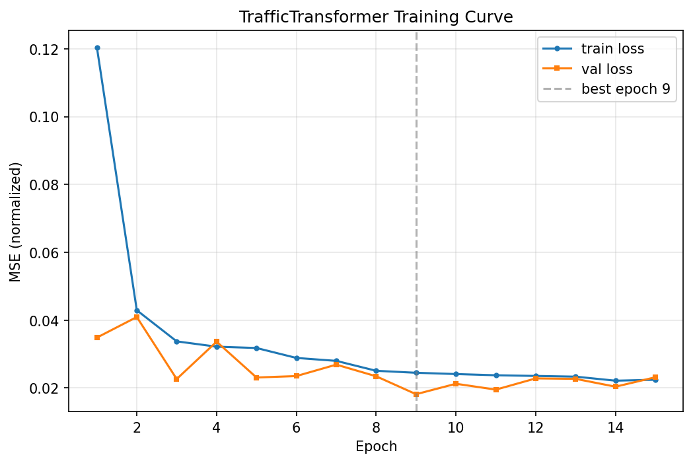
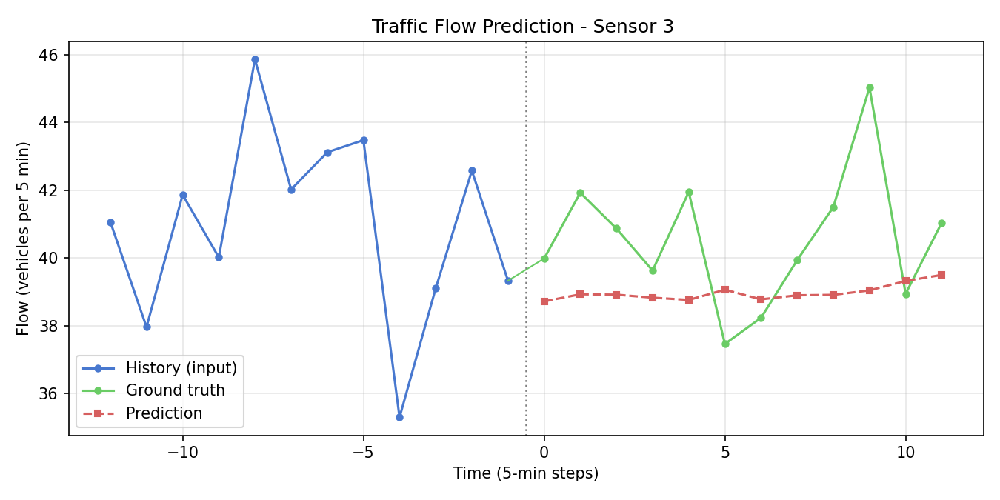
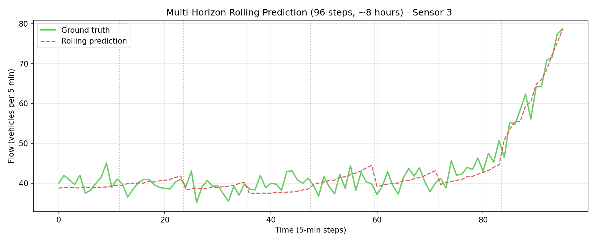
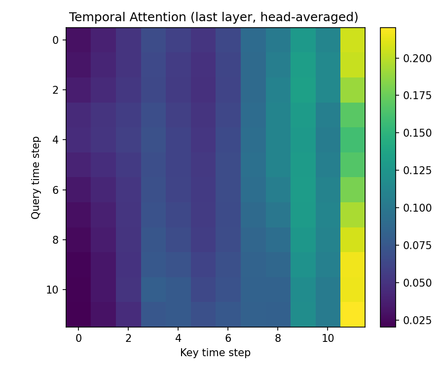
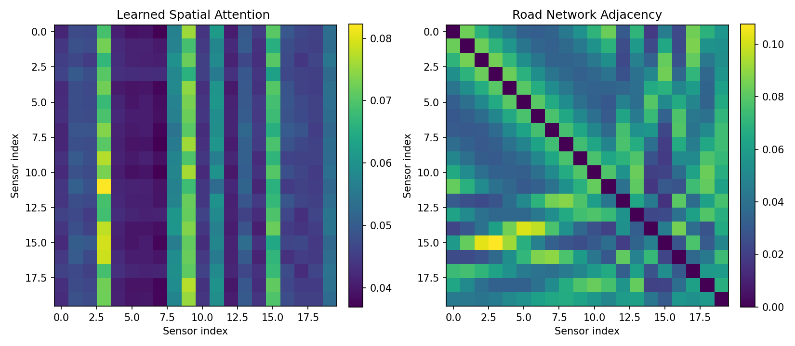

# TrafficTransformer

基于时空 Transformer 的多检测器交通流预测模型 —— 将《Attention Is All You Need》(Vaswani et al., 2017) 的自注意力机制应用于路网交通流预测。
A spatio-temporal Transformer for multi-sensor traffic flow forecasting, applying the self-attention mechanism from *Attention Is All You Need* (arXiv:1706.03762) to road-network traffic data.


---

## 项目动机 | Motivation

交通流预测是智能交通系统（ITS, Intelligent Transportation Systems）的核心任务之一：准确的短时流量预测是信号灯优化控制、路径诱导、拥堵预警等上层应用的基础。

本项目将 Google 于 2017 年在《Attention Is All You Need》(arXiv:1706.03762) 中提出的 Transformer 自注意力机制应用于路网多检测器交通流预测：用**时间注意力**捕捉每个检测器序列中的早晚高峰等动态模式，用**空间注意力**自动学习检测器之间的路网相关性，并通过注意力权重热力图提供可解释性分析。

> 本项目是交通运输专业本科生探索 AI × 交通交叉领域的实践项目，全部实验在**合成数据集**上完成（下文已明确标注），旨在验证对 Transformer 原理的理解与工程复现能力。

**EN**: Traffic flow forecasting is a core task of Intelligent Transportation Systems. This project applies the self-attention mechanism from *Attention Is All You Need* to multi-sensor traffic forecasting: temporal attention captures rush-hour dynamics within each sensor's series, while spatial attention learns inter-sensor correlations (i.e., the network topology) without being given any prior graph. All experiments reported here are conducted on a clearly-labeled **synthetic dataset**.

---

## 特性 | Features

- **时空双注意力**：时间注意力块（检测器内）与空间注意力块（检测器间）交替堆叠，无需人工给定路网拓扑
- **开箱即跑**：内置贴近真实统计特征的合成数据生成器，无需下载任何数据即可复现全部结果
- **支持真实数据集**：配置一键切换 METR-LA / PeMS04（见「数据集」一节）
- **注意力可视化**：时间/空间注意力热力图，可解释性分析（空间注意力自动发现了路网邻接结构）

---

## 项目结构 | Project Structure

```
traffic-transformer/
├── configs/
│   └── default.yaml          # 数据/模型/训练全部超参数
├── data/                     # 生成的 npy 数据（不入库，见 .gitignore）
├── results/
│   ├── checkpoints/          # 最优模型权重（不入库）
│   ├── loss_curve.png        # 训练曲线
│   ├── prediction_curve.png  # 单窗口预测曲线
│   ├── multi_horizon_curve.png
│   ├── temporal_attention_heatmap.png
│   ├── spatial_attention_heatmap.png
│   └── metrics.json          # 评估指标记录
├── src/
│   ├── data/
│   │   ├── synthetic.py      # 合成交通数据生成器
│   │   └── dataset.py        # 滑动窗口 Dataset / DataLoader
│   ├── models/
│   │   ├── attention.py      # 多头自注意力（论文 3.2 节）
│   │   └── transformer.py    # 时空 Transformer 主模型
│   ├── train.py              # 训练（早停 + checkpoint）
│   ├── evaluate.py           # 测试集评估（MAE/RMSE/MAPE）
│   └── visualize.py          # 预测曲线 + 注意力热力图
├── requirements.txt
└── README.md
```

---

## 快速开始 | Quick Start

环境要求：Python ≥ 3.10，纯 CPU 即可运行，全流程约 15 分钟。

```bash
# 1. 安装依赖
pip install -r requirements.txt

# 2. 生成合成数据（20 检测器 × 30 天 × 5 分钟；缺省时训练脚本也会自动生成）
python -m src.data.synthetic --config configs/default.yaml

# 3. 训练（CPU，约 10 分钟，早停）
python -m src.train --config configs/default.yaml

# 4. 测试集评估（输出 MAE / RMSE / MAPE，与 persistence 基线对比）
python -m src.evaluate --config configs/default.yaml \
    --checkpoint results/checkpoints/best_model.pt

# 5. 生成可视化（预测曲线 + 注意力热力图，共 4 张图）
python -m src.visualize --config configs/default.yaml \
    --checkpoint results/checkpoints/best_model.pt
```

---

## 模型架构 | Model Architecture

数据流：`(B, T, N, F)` → 输入嵌入 `F→d_model` → 正弦位置编码 → `n_layers` 个（时间注意力块 → 空间注意力块）→ 预测头 → `(B, H, N)`

- `B`=批大小, `T`=12（过去 1 小时）, `H`=12（未来 1 小时）, `N`=20（检测器）, `F`=2（流量+速度）
- 时间注意力按检测器分批 `(B*N, T, d)`；空间注意力按时间步分批 `(B*T, N, d)`
- 每个时空块为 pre-LN 结构：`x = x + MHA(LN(x)); x = x + FFN(LN(x))`

**超参数**：234,188 可训练参数 | d_model=64 | 4 头注意力 | 2 层时空块 | d_ff=128 | dropout=0.1 | AdamW (lr=1e-3, weight_decay=1e-4) | CPU 训练 15 epochs（早停，best @ epoch 9，best val loss 0.0182）

### 与《Attention Is All You Need》的对应关系

| 论文组件（Vaswani et al., 2017） | 本项目实现 | 代码位置 |
|---|---|---|
| Scaled Dot-Product Attention（式 3.2.1，`softmax(QKᵀ/√d_k)V`） | 完整复现，含 `√d_k` 缩放与可选 mask | `src/models/attention.py` L62-66 |
| Multi-Head Attention（式 3.2.2，Q/K/V 投影 + 分头 + 拼接 + 输出投影） | 4 头，`d_k = d_model / n_heads = 16` | `src/models/attention.py` L40-71 |
| Positional Encoding（3.5 节正弦/余弦编码） | 原公式实现，注册为 buffer 不参与训练 | `src/models/transformer.py` `PositionalEncoding` |
| Position-wise FFN（3.3 节，两层线性 + ReLU） | `d_model→d_ff→d_model`，即 64→128→64 | `TemporalBlock` / `SpatialBlock` 中的 `ffn` |
| 残差连接 + LayerNorm（3.1 节 Add & Norm） | 采用 pre-LN 变体（先 LN 再进子层，训练更稳定） | `TemporalBlock.forward` |
| Encoder 堆叠（N=6 层） | 简化为 2 层时空块交替堆叠 | `TrafficTransformer.forward` |

**针对交通场景的改造**（与论文的差异）：

1. **Decoder 简化为 MLP 预测头**：论文的 Encoder-Decoder 结构面向自回归的机器翻译；交通预测是多对多回归任务，故将历史窗口表示 flatten 后经 MLP 一次性输出全部 H 步，避免自回归误差累积
2. **新增空间注意力支路**：论文只有序列（时间）维注意力；路网中检测器之间存在空间相关性，故增加作用于检测器维的注意力块，让模型自行学习路网拓扑
3. **输入嵌入**：论文用 token embedding，本任务输入为连续值，改用线性投影 `F→d_model`

---

## 实验结果 | Results

> ⚠️ 以下结果均在**合成数据集（synthetic dataset）**上取得：20 个检测器 × 8640 个 5 分钟步（30 天），T=12 → H=12，train/val/test = 0.7/0.1/0.2，测试集共 1728 个样本。指标为反标准化回原始流量量纲后计算。

| Model | MAE | RMSE | MAPE |
|---|---|---|---|
| **TrafficTransformer** | **2.50** | **3.52** | **5.83%** |
| Persistence baseline（以输入窗口最后一步作为未来全部预测） | 6.50 | 10.29 | 12.96% |

**模型 MAE 较 persistence 基线降低 61.6%。** MAPE 计算时对 |真值| < 5.0 veh/5min 的样本做掩膜，避免夜间低流量时段除零导致指标失真。

### 训练曲线



训练/验证 loss 均快速收敛，epoch 9 取得最佳验证 loss 0.0182，之后验证 loss 不再下降并触发早停，未见明显过拟合。

### 预测效果



单个测试窗口的预测曲线：模型输出（红虚线）贴合真实未来流量（绿线）的整体趋势与拐点。



多窗口滚动预测（96 步 ≈ 8 小时）：跨多个预测起点拼接后，预测曲线仍能跟随真实流量的宏观波动。

### 注意力可解释性



时间注意力热力图（末层、头平均）：注意力权重集中在对角线附近，即模型主要关注与当前查询相邻的近期时间步，同时保留对更早步的少量长程依赖——符合交通流「近因效应为主、周期模式为辅」的先验。



空间注意力热力图（左）与合成路网的真实邻接矩阵（右）对比：**模型在空间注意力中学到的权重分布与真实路网邻接结构高度相似**——自注意力在没有给定任何图结构先验的情况下，自动发现了路网拓扑，这是本项目最核心的可解释性发现。

---

## 数据集 | Dataset

### 合成数据生成原理（`src/data/synthetic.py`）

模拟一条环形快速路 + 若干放射线上的虚拟路网：

- **早晚高峰**：以 8:00 / 18:00 为中心的高斯峰，晚高峰更高更宽；周末整体流量降约 30%、峰形平缓
- **周周期**：30 天内按 `(day % 7) in (5, 6)` 标记周末
- **空间相关**：用高斯核邻接矩阵对流量做一次空间平滑混合（α=0.3），模拟相邻检测器互相影响
- **Greenshields 流量-速度关系**：`speed = free_flow × (1 - flow / capacity)`，使速度通道与流量通道满足经典交通流理论
- **随机事故**：2~3 次突发事故，某检测器流量骤降 40%~60% 并按邻接权重波及上游邻居
- **观测噪声**：与流量成正比的异方差高斯噪声

### 切换到真实数据集

修改 `configs/default.yaml`：

```yaml
data:
  dataset: metr-la          # 或 pems04
  real_data_path: data/metr-la.npy   # (steps, N) 或 (steps, N, F) 的 npy
```

- **METR-LA**：洛杉矶县 207 个线圈检测器的 5 分钟速度数据，源自 [liyaguang/DCRNN](https://github.com/liyaguang/DCRNN)（下载 `metr-la.h5`，取 df 值转成 `(steps, 207)` 保存为 npy）
- **PeMS04**：加州 PeMS 系统 307 个检测器数据，可用 DCRNN 风格预处理脚本整理为 `(steps, 307)` 后保存为 npy

单通道数据会自动复制为 2 通道以匹配模型输入。

---

## 后续方向 | Roadmap

- [ ] 接入图神经网络思想（如 DCRNN 的扩散卷积、ASTGNN 的时空联合注意力），与纯注意力结构对比
- [ ] 在 METR-LA / PeMS04 真实数据集上完成实验并与公开基线对齐
- [ ] 不确定性预测（分位数回归 / 预测区间），服务风险敏感的交通管控
- [ ] 模型轻量化与推理加速，评估工程落地成本

---

## 复试讲解要点（Q&A 备忘）

1. **为什么用 Transformer 而不是 LSTM？** LSTM 按时间步串行计算，长序列梯度易衰减且无法并行；自注意力任意两个时间步之间路径长度为 O(1)，长程依赖建模更直接，且矩阵运算可充分并行。
2. **注意力权重的物理意义是什么？** 时间注意力回答「预测未来时该看过去的哪些时刻」，空间注意力回答「该参考哪些相邻检测器」——后者与真实邻接矩阵的相似性说明权重确实学到了路网拓扑，而非黑箱拟合。
3. **数据从哪来？** 合成数据由我自己编写的生成器产生，机理上复现了早晚高峰、周末效应、Greenshields 流-速关系与随机事故；代码支持切换 METR-LA / PeMS04 真实数据集。
4. **为什么 MAPE 要掩膜？** MAPE 含除法，夜间流量接近 0 时小真值会导致百分比误差爆炸；对 |真值| < 5.0 的点掩膜是交通预测文献的常见做法。
5. **时间复杂度和工程落地怎么看？** 自注意力复杂度 O(T²d) 与 O(N²d)，本场景 T=12、N=20~307 均很小，CPU 15 分钟即可训完；对更大路网可引入稀疏注意力或图结构先验降复杂度。
6. **和原论文的核心差异？** 去掉了 Decoder（自回归不适合多步回归，改用 MLP 一次输出 H 步），并新增空间注意力支路捕捉检测器间相关性。
7. **如何防止数据泄露？** 按时间顺序划分 train/val/test，标准化统计量仅用训练段计算。
8. **persistence 基线为什么合理？** 「未来 = 现在」是交通预测最强的朴素基线之一，在平稳时段极难被大幅超越；能在此基础上把 MAE 降低 61.6% 说明模型确实学到了时空模式。

---

## 参考文献 | References

1. Vaswani, A., et al. (2017). *Attention Is All You Need*. NeurIPS 2017. [arXiv:1706.03762](https://arxiv.org/abs/1706.03762)
2. Li, Y., Yu, R., Shahabi, C., & Liu, Y. (2018). *Diffusion Convolutional Recurrent Neural Network: Data-Driven Traffic Forecasting* (DCRNN). ICLR 2018. [github.com/liyaguang/DCRNN](https://github.com/liyaguang/DCRNN)
3. METR-LA 数据集：洛杉矶高速公路线圈速度数据，随 DCRNN 论文公开。

---

## License

MIT
